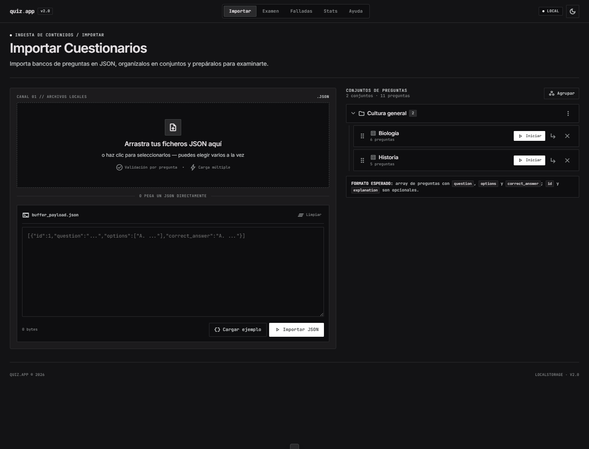
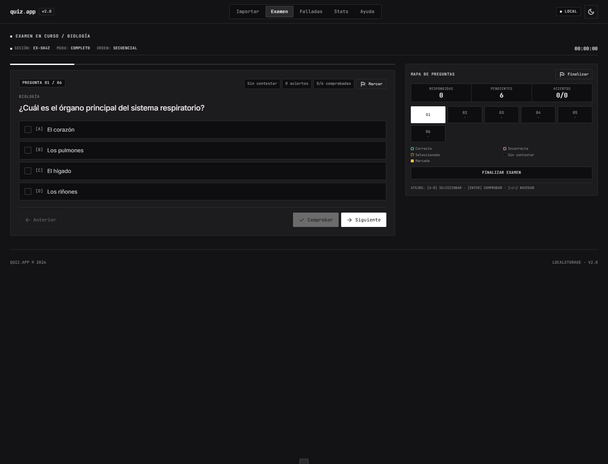

# QuizApp

Aplicación web para estudiar con tus propios cuestionarios. Importa las preguntas
en un archivo JSON, realiza exámenes y repasa las que falles.

No necesita instalación, cuenta ni servidor: todo funciona en el navegador y se
guarda en tu propio dispositivo.

| Importa tus conjuntos | Practica con exámenes |
| --- | --- |
|  |  |

## Cómo empezar

1. Descarga o clona este repositorio.
2. Abre `index.html` en tu navegador.
3. Pulsa **Cargar ejemplo** o importa tu propio archivo JSON.
4. Ve a **Examen**, elige el conjunto y empieza a practicar.

También puedes servir la carpeta por HTTP (útil si quieres publicarla en GitHub
Pages):

```bash
python -m http.server 8000
```

Y abrir <http://localhost:8000>.

Para publicarla gratis con GitHub Pages: **Settings → Pages → Deploy from a
branch → `main` / `/ (root)`**.

## Funciones

- **Importar varios JSON a la vez**, arrastrándolos, seleccionándolos o pegando
  el texto.
- **Grupos de conjuntos** para organizar asignaturas o temas.
- Examen **completo** o **solo con las preguntas falladas**.
- Orden **aleatorio** o **secuencial**.
- **Límite de 60 segundos por pregunta** (opcional): al agotarse, la respuesta
  se comprueba automáticamente.
- **Modo práctica** (activado por defecto): muestra la explicación y el aviso de
  acierto o fallo justo después de comprobar. Desactívalo para ocultar ese bloque
  (las opciones seguirán marcando la correcta y cuál fallaste).
- Navegación libre entre preguntas y **mapa visual** del examen.
- **Marcar preguntas** para repasarlas después.
- Soporte de **respuesta única y múltiple**, detectado automáticamente.
- Botón **Comprobar** con explicación y estado correcto/incorrecto.
- **Colores semánticos**: verde para aciertos, rojo para fallos y ámbar para
  preguntas seleccionadas o marcadas, sin romper el estilo monocromo.
- **Resultados** con nota, aciertos, fallos y preguntas sin contestar.
- **Historial** de exámenes y estadísticas, con **desglose de falladas por
  examen**.
- Lista de **preguntas falladas agrupada por examen**: cada pregunta aparece una
  sola vez con el número total de fallos, filtro por examen, repaso directo del
  conjunto y exportación a TXT o JSON.
- **Validación por pregunta** al importar: se ignoran las preguntas sin
  `question`, con menos de dos opciones o con una respuesta que no coincide con
  ninguna opción.
- Tema **oscuro o claro**.
- Todos los datos se guardan en el `localStorage` del navegador.

## Formato del JSON

El archivo debe contener un array de preguntas:

```json
[
  {
    "id": 1,
    "question": "¿Cuál es el animal terrestre más rápido?",
    "options": ["León", "Guepardo", "Tigre", "Canguro"],
    "correct_answer": "Guepardo",
    "explanation": "El guepardo alcanza hasta 120 km/h en distancias cortas."
  },
  {
    "id": 2,
    "question": "¿Cuáles de estos son lenguajes de programación? (marca 2)",
    "options": ["Python", "HTML", "Java", "CSS"],
    "correct_answer": "A, C",
    "explanation": "Python y Java son lenguajes de programación; HTML y CSS no."
  }
]
```

- `question`, `options` y `correct_answer` son obligatorios. `id` y
  `explanation` son opcionales; si falta `id`, se asigna un número.
- `options` necesita al menos dos textos no vacíos.
- `correct_answer` puede ser el texto exacto de una opción, una letra (`"A"`),
  varias letras separadas (`"A, C"`, `"A and C"` o `"A y C"`) o varios textos
  exactos separados por comas o «y» (`"Marte, Saturno"`).
- Si una opción incluye una letra en su texto, como `"A. París"`, usa ese texto
  exacto. Si la opción es solo `"París"`, escribe `"París"` o la letra de su
  posición.

## Privacidad

Todo se guarda únicamente en el navegador. La aplicación no tiene servidor, no
crea cuentas, no incluye analítica ni claves de API y no envía tus preguntas,
respuestas o resultados a ningún sitio. Si borras los datos del navegador, se
borrarán también tus conjuntos e historial.

La tipografía y los iconos se cargan desde Google Fonts; el navegador contacta
con ese servicio para descargarlos, pero no se le envían preguntas ni resultados.
Si bloqueas esas fuentes, la app sigue funcionando con las fuentes del sistema
(aunque los iconos pueden mostrarse como texto).

En GitHub Pages, todos los proyectos publicados bajo el mismo subdominio
comparten el almacenamiento del navegador. Si guardas exámenes sensibles y
publicas otros proyectos en ese mismo subdominio, considera usar un dominio
propio o abrir QuizApp en local.

## Estructura

Todo el código está en `index.html`: HTML, CSS y JavaScript en un único archivo.
No hay paso de compilación ni dependencias que instalar.

## Licencia

[MIT](LICENSE).
